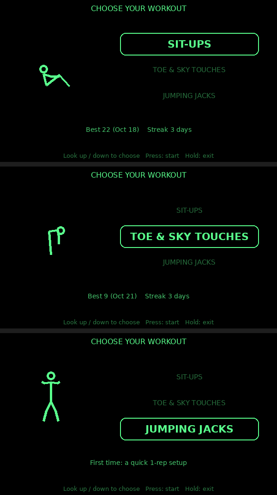
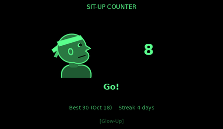
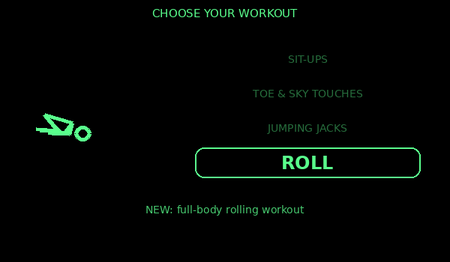

# Workout Counter for MemoMind glasses

Count your reps hands-free with MemoMind smart glasses. The glasses sense your head's motion, count each rep, and show a fun animation on the display, while a companion phone app keeps your history, high scores and streak — and plays the sound effects.

Built on the [MemoMind open platform](https://github.com/memomind-open/plugin-open-platform). Not affiliated with MemoMind.


## Features

- **Three workouts that a head-worn sensor can really count**
  - **Sit-ups** — big head tilt; waits until you're lying down before it starts
  - **Toe & sky touches** — touch your toes, then reach for the sky
  - **Jumping jacks** — counts the landing jolts
- **One-time setup per workout** — do one slow rep (or three jacks) and it learns *your* range of motion, so it isn't fooled by small head bobs
- **Head-pointer menu** — tilt your head up/down to pick a workout, press the glasses button to start

  
- **Seven animation styles** — Stick Figure (default), Coach Head, Glow-Up (he evolves at 10 / 25 / 50 reps), Aura (+100 aura per rep, −1000 if you pause), Judgy Cat, Stonks, and Ring. Each character moves differently for each workout.

  
- **Sound effects** for every style, rising in pitch as your count climbs (played by the phone)
- **Phone tracker** — per-workout history, high score with date, 14-day chart, and one shared workout streak
- **Roll** — a fourth "workout" that is actually a prank:

  

All art and sounds are original and generated by the scripts in `glasses/situp_counter/tools/`.

## What you need

- MemoMind glasses and the MemoMind phone app (with developer installs available)
- MemoMind's SDK: <https://github.com/memomind-open/plugin-open-platform> (with Python 3 and Node.js — see its README)

## Install

1. Clone MemoMind's SDK if you haven't:
   ```
   git clone https://github.com/memomind-open/plugin-open-platform.git
   ```
2. Clone this repository next to it, then copy the app into the SDK:
   ```powershell
   git clone https://github.com/ZoneDK-sudo/workout-glasses-app.git
   cd workout-glasses-app
   .\install.ps1                         # Windows (SDK in your home folder)
   .\install.ps1 -Sdk D:\path\to\plugin-open-platform
   ```
   ```sh
   ./install.sh ~/plugin-open-platform   # macOS / Linux
   ```
   The script also copies MemoMind's web SDK file from your SDK into the phone app (it isn't redistributed here).
3. Build, from the SDK folder:
   ```
   py build.py          # Windows
   ./build.py           # macOS / Linux
   ```
4. Open MemoMind's Plugin Studio (`Studio/windows/gm-plugin-studio-desktop.exe` on Windows), select **Workout Tracker** (phone) and **Workout Counter** (glasses), and scan the QR code with the MemoMind app.

## Using it

| | Glasses button | Accessory buttons |
|---|---|---|
| **Menu** | press = start · double = re-centre pointer · hold = exit | Up/Down = move |
| **Workout** | press = pause/resume (skip setup) · double = back to menu · hold = exit | Left/Right = style · Up/Down = sensitivity |

- **Sound plays from your phone.** Open Workout Tracker, tap **"Tap to turn on sound"**, and keep the page open during your workout. (The glasses' speaker can't be reached by phone plugins.)
- **Recalibrate** a workout from its tab in the phone app if your counts feel off.

## How it works

- **Glasses plugin** (`glasses/situp_counter`, C): reads the head-motion sensor, runs a per-workout rep detector, draws the display with LVGL, and talks to the phone over Bluetooth.
  - Sit-ups and toe & sky use head tilt; jumping jacks use acceleration peaks.
  - The one-rep setup measures your motion, so the sensor's raw units never matter.
  - Animations are run-length encoded (glow-up tiers and aura stored as differences) to fit the glasses' package size limit; other figures are drawn live from lines.
- **Phone plugin** (`phone/situp-tracker`, HTML/JS): stores history, high scores, streak and each workout's setup; plays sounds with Web Audio (one tap unlocks them all).
- **Sync protocol** `fox89.situp-sync` 2.0 is documented at the top of `situp_counter.c`.

## Changing the art or sounds

The generators live in `glasses/situp_counter/tools/` and expect to run inside the SDK copy (after installing). They need Python with Pillow and lameenc:
```
py -m pip install pillow lameenc
py GlassSDK/examples/situp_counter/tools/make_sprites.py   # glasses art + phone style previews
py GlassSDK/examples/situp_counter/tools/make_sounds.py    # phone sounds (sounds-data.js)
```
Then `py build.py`, and copy the changed files back here.

## License

MIT for the files in this repository — see [LICENSE](LICENSE). MemoMind's SDK is not included and is covered by MemoMind's own terms.
